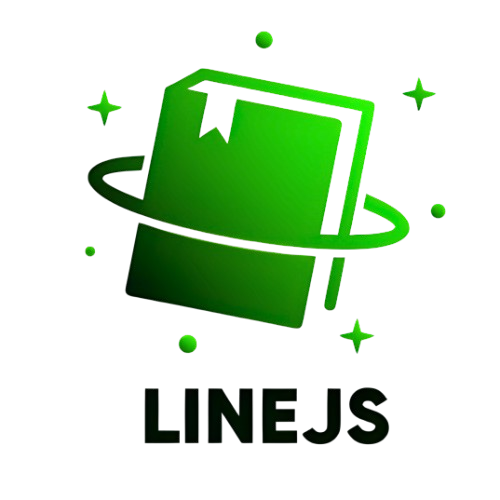

# LINEJS

[](https://www.npmjs.com/package/@evex-dev/linejs)
[](https://jsr.io/@evex/linejs)
[](https://jsr.io/@evex/linejs)
[](https://jsr.io/@evex)
\
[](https://discord.gg/evex)
[](https://技術者倫理.com)

<center>
  
</center>

<center> <b>LINEJS</b> is a JavaScript library for creating a LINE SelfBot. </center>

---

##### <center>❓ Question: Join our [Discord community](https://discord.gg/evex)</center>

##### <center>📚 Documentation: [Check out the full documentation](https://linejs.evex.land)</center>

##### <center>🤖 AI Generated Documentation: [DeepWiki - LINEJS](https://deepwiki.com/evex-dev/linejs)

---

## Installation

Supports Node.js (22.18+ or 24.11+), Bun, and Deno, with TypeScript types included.

```sh
npm install @evex-dev/linejs
pnpm add @evex-dev/linejs
yarn add @evex-dev/linejs
bun add @evex-dev/linejs
```

The library is also published to JSR as `@evex/linejs` for Deno and JSR users:

```sh
npx jsr add @evex/linejs
deno add jsr:@evex/linejs
```

### For AI coding agents

Install LINEJS as a skill so Codex, Claude Code, and other coding
agents know how to work with the library:

```sh
npx skills add evex-dev/linejs --skill linejs
```

You can `git clone` the latest development version and link it locally:

```sh
git clone https://github.com/evex-dev/linejs.git
cd linejs
pnpm install
pnpm run build
```

##### Documentation is [https://linejs.evex.land](https://linejs.evex.land/)

## Migrating from v1

The v1 → v2 surface change is large enough that a step-by-step manual
diff isn't worth maintaining. Install the agent skill (see
[Installation](#installation)) and ask your coding agent to migrate
the affected files — it will read the skill's roadmap, pull the
current API shapes, and rewrite call sites against the live source.

## Browser Support

For now, please use "https://esm.sh/@evex-dev/linejs".

Example is [here](./example/browser).

## LINEJS Types

Please see [@evex-dev/linejs-types](https://www.npmjs.com/package/@evex-dev/linejs-types) (JSR: [@evex/linejs-types](https://jsr.io/@evex/linejs-types)).\
In short, TypeScript types and enums (such as ReactionType (0, 1, 2, 3),
MessageType, etc.) are provided.

## Provided Packages

- client - (@evex-dev/linejs)
  - Client - LINE SelfBot Client
- base - (@evex-dev/linejs/base)
  - BaseClient - LINE SelfBot API Client
- call - (@evex-dev/linejs/call)
  - Call control-plane and media helpers
  - [Explicit incoming 1:1 audio answering](../../docs/INCOMING_AUDIO.md)
- thrift - (@evex-dev/linejs/thrift)
  - Thrift - Thrift read/write
- storage - (@evex-dev/linejs/storage)
  - BaseStorage - LINE Client Storage Type
  - MemoryStorage - LINE Client Memory Storage
  - FileStorage - LINE Client File Storage
- types - (@evex-dev/linejs-types)
  - All Types for LINE

## Development

Requires Node.js 22.18+ (or 24.11+) and pnpm.

```sh
pnpm install
pnpm run build
pnpm run check
pnpm test
```

## Authors

- Owner & Developer: [Piloking](https://github.com/piloking)
- Developer: [EdamAme-x](https://github.com/EdamAme-x)
- Developer: [MocA-Love](https://github.com/MocA-Love)
- Developer: [Hafusun](https://github.com/hafusun)

## References

- [DeachSword/CHRLINE](https://github.com/DeachSword/CHRLINE)

- [DeachSword/CHRLINE-Thrift](https://github.com/DeachSword/CHRLINE-Thrift/)

- [WEDeach/CHRLINE-Patch](https://github.com/WEDeach/CHRLINE-Patch)

- [discordjs/collection](https://www.npmjs.com/package/@discordjs/collection)
